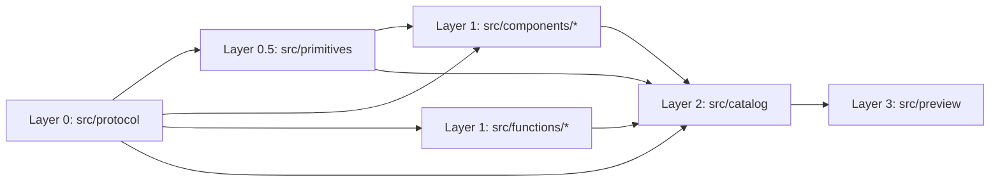

# ARCHITECTURE.md — Layering DAG, Deep Modules & Invariants

## 1. Architectural Overview

`a2ui-catalog` (**A2UI Lumina v1.0**) is organized around **progressive disclosure**, **vertical locality** (each component and function owns its schema, prompt, examples, renderer, and seam tests in one folder), and **mechanical enforcement** (`dependency-cruiser`, `eslint`, and `tests/catalog-contract.test.ts`).

---

## 2. Layer Definitions & Permitted Import Edges

| Layer | Path | Responsibility | Allowed Internal Imports |
| :--- | :--- | :--- | :--- |
| **Layer 0** | `src/protocol/` | A2UI v1.0 constants, Zod `Dynamic*` / `Action` / `Checkable` schemas, wire normalization, toast pub/sub, and `defineCatalogComponent` / `defineCatalogFunction` descriptors. **Zero React or DOM imports.** | None (leaf layer) |
| **Layer 0.5** | `src/primitives/` | Shared UI helpers (`AdaptiveOverlay`, icon registry, motion springs, theme context, safe runtime value readers). | `src/protocol/` |
| **Layer 1A** | `src/components/<slug>/` | Vertical Deep-Module slice for a single A2UI v1.0 component (41 slices total). | `src/protocol/`, `src/primitives/`, or own slice files |
| **Layer 1B** | `src/functions/<slug>/` | Vertical Deep-Module slice for A2UI v1.0 functions (`formatCompactNumber`, `formatPercent`, `formatRelativeTime`, `copyToClipboard`, `shareContent`, `setValue`, plus `basic-v1`). | `src/protocol/` or own slice files |
| **Layer 2** | `src/catalog/` | Canonical `catalogRegistry`, `catalog.json` compiler (`compiler.ts`), LLM prompt builder, domain profile slicer, and React `Catalog` adapter. | `src/protocol/`, `src/primitives/`, `src/components/<slug>/index.ts`, `src/functions/<slug>/index.ts` |
| **Layer 3** | `src/preview/` | Isolated worktree-safe Vite preview harness rendering every component's `examples.json` fixtures. | `src/catalog/`, `src/protocol/`, `src/primitives/` |

### Forbidden Edges (Enforced by `.dependency-cruiser.cjs`)
1. **No deep imports across slices:** Nothing outside `src/components/<slug>/` (or `src/functions/<slug>/`) may import internal files (`schema.ts`, `renderer.tsx`, private helpers); external callers import exclusively from `index.ts`.
2. **Protocol purity:** `src/protocol/` must never import from `primitives`, `components`, `functions`, `catalog`, `preview`, `react`, or `react-dom`.
3. **Upward-only flow:** `src/components/` and `src/functions/` must never import from `src/catalog/` or `src/preview/`.
4. **Zero circular dependencies:** Cycles anywhere under `src/` fail `pnpm lint`.

---

## 3. The Deep Module Rule & Slice Contract

Following John Ousterhout's *Deep Modules* principle, every component slice exposes a **narrow, uniform `index.ts` descriptor** while hiding layout math, SVG paths, keyboard handling, and sub-views internally.

Every directory `src/components/<slug>/` MUST contain:
- `schema.ts` — Zod `PropsSchema`, A2UI `ComponentApi`, `allowedChildren` composition metadata, and inferred `Props` type.
- `prompt.md` — Concise (`20..1500` chars) LLM usage guidance referencing only real schema property names.
- `examples.json` — Non-empty array of `{ title, props }` fixtures validated against `PropsSchema` in [tests/catalog-contract.test.ts](tests/catalog-contract.test.ts).
- `renderer.tsx` — Concrete component view (`<= 350` non-blank, non-comment lines; zero `any`; zero `as` casts).
- `index.ts` — Calls `defineCatalogComponent(...)` and re-exports only the descriptor and `Props` type.
- `<slug>.test.tsx` — Black-box seam test validating schema parsing and rendering through `index.ts`.

---

## 4. Workspace Package Projection

Workspace packages under `packages/*` and `apps/*` project the single source of truth in `src/`:
- `packages/tokens` (`@a2ui-catalog/tokens`) — W3C design tokens compiled to CSS variables, TS springs, and Swift/Kotlin/Dart stubs.
- `packages/core` (`@a2ui-catalog/core`) — Framework-free projection of `src/protocol`, `src/functions`, and component `ComponentApi` schemas.
- `packages/schema` (`@a2ui-catalog/schema`) — Vendored A2UI v1.0 Draft 2020-12 meta-schemas, upstream golden examples, and compiled `catalog.json`.
- `packages/react` (`@a2ui-catalog/react`) — React catalog binding (`@a2ui/react`) over `src/catalog` and `src/primitives`.
- `apps/agent`, `apps/explorer`, `apps/studio` — Live A2A v1.0 SSE agent server, interactive 41-component Explorer/Playbook, and Web × Mobile SxS Studio.

Related references: [docs/GLOSSARY.md](docs/GLOSSARY.md), [docs/adr/0001-vertical-deep-modules.md](docs/adr/0001-vertical-deep-modules.md), and [docs/QUALITY_SCORE.md](docs/QUALITY_SCORE.md).
