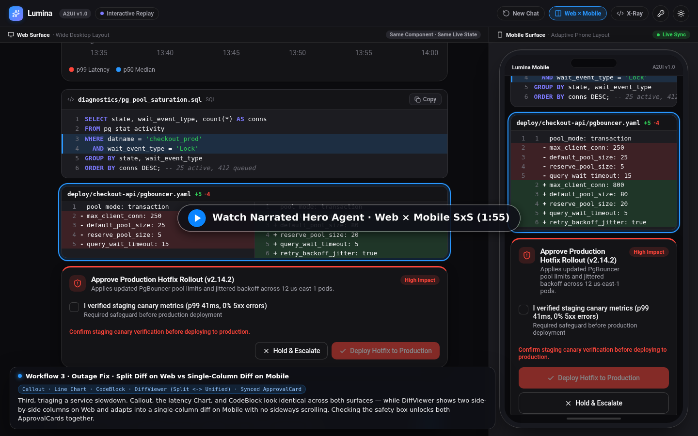
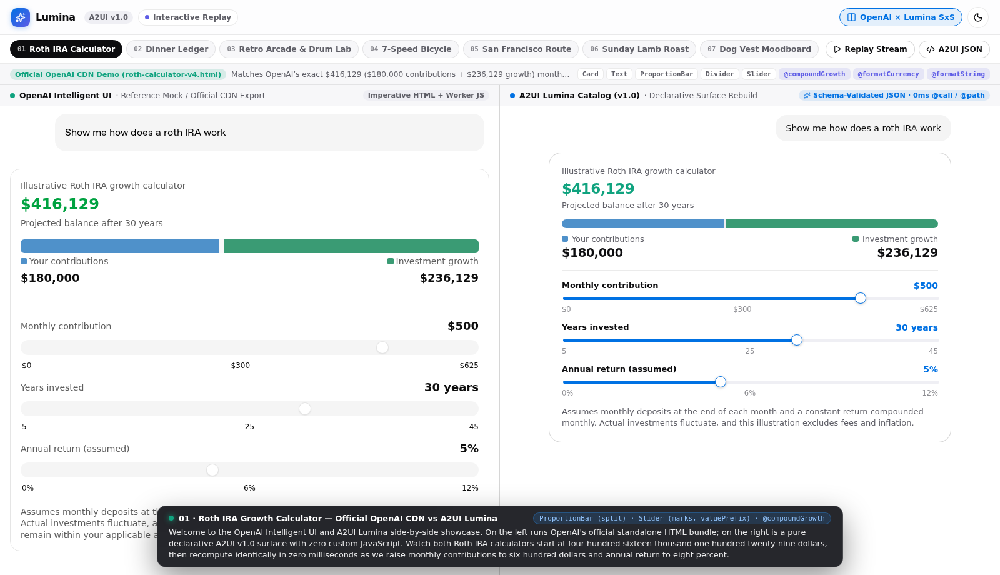

# A2UI Lumina Catalog (`v1.0`)

**A2UI Lumina** is a 49-component, 24-function **A2UI v1.0** UI catalog purpose-built for intelligent agentic applications. Implemented in **React** for Web and Mobile—and backed by a framework-free schema and token contract ready for **Angular, Flutter, iOS (SwiftUI), and Android (Jetpack Compose)**—Lumina gives AI agents a rich, safe, and tactile vocabulary for turning streamed JSON into modern interactive interfaces.

---

## Why A2UI Lumina?

1. **Bridges the A2UI Basic Catalog Gap (Without Becoming a Web Framework)**
   - The upstream A2UI v1.0 Basic Catalog ships 18 foundational primitives (`Row`, `Column`, `Text`, `Button`, `TextField`, etc.) intended for early protocol experimentation.
   - Real agentic workflows need semantic building blocks that Basic lacks: collapsible reasoning traces (`ThoughtTrace`), multi-step execution trackers (`StepTimeline`, `ChecklistCard`), grounded web citations (`SourceList`), interactive schematics & maps (`AnnotatedDiagram`, `RouteMap`), syntax-highlighted code and patch reviews (`CodeBlock`, `DiffViewer`), quantitative & proportional views (`StatMetric`, `Chart`, `ProportionBar`, `DataTable`, `ComparisonMatrix`, `KeyValueList`, `SplitLedger`, `QuizCard`), tactile palettes (`SwatchPicker`), sandboxed interactive canvases (`MicroApp`), human-in-the-loop safety gates (`ApprovalCard`), expandable deliverables (`ArtifactCard`), and one-tap turn continuation (`FollowUpSuggestions`).
   - Lumina stays strictly focused on **agentic UI building blocks** rather than general-purpose web page layout or raw HTML/CSS generation.
   - Every Basic Catalog v1.0 primitive is preserved as a **100% compatible superset** (verified against all 43 upstream Basic v1.0 golden examples).

2. **One Declarative Stream Across Desktop, Tablet & Mobile (Light & Dark)**
   - Agents emit a single A2UI v1.0 JSON stream; the renderer adapts ergonomics automatically per surface:
     - `Modal` and `ArtifactCard` render as frosted dialogs / split Canvas drawers on Desktop and become draggable bottom sheets on Mobile.
     - `ComparisonMatrix` renders a side-by-side table on Desktop and swipeable snap cards on Mobile.
     - `DiffViewer` switches from two-column `split` diffs on Desktop to single-column `unified` diffs on Mobile.
     - `Grid` adapts column counts cleanly across Desktop, iPad, and iPhone, with `>= 44px` coarse-pointer touch targets, `tabular-nums` alignment on all numbers, and full `prefers-reduced-motion` support.

3. **Designed for Multi-Platform Extensibility**
   - Normative schemas (`packages/schema/catalog.json` + `@a2ui-catalog/core`) have **zero React or DOM dependencies**, and W3C design tokens (`@a2ui-catalog/tokens`) emit CSS custom properties alongside Swift, Kotlin, and Dart token stubs so native and non-React renderers share one protocol contract.

---

## Narrated Video Walkthroughs

### 1. Live Hero Agent Studio — Web × Mobile Side by Side (`1:55` · Voiceover)

Shows **Web on the left** and a **live synchronized Mobile surface on the right** driven by a single A2UI v1.0 stream across all 4 multi-turn hero workflows (*Executive Tokyo Trip*, *AI Semiconductor Research*, *Service Outage & Safe Rollout*, and *Monthly Budget Optimizer* with Protocol X-Ray). Each component shares the exact same visual language and state while adapting layout ergonomics to its screen size.

<video src="docs/media/lumina-hero-agent-studio-narrated.mp4" poster="docs/media/poster-hero-studio-sxs.png" controls width="100%">
  <a href="docs/media/lumina-hero-agent-studio-narrated.mp4">
    
  </a>
</video>

> **[▶ Open Narrated Video (`1:55` · MP4 with Voiceover)](docs/media/lumina-hero-agent-studio-narrated.mp4)** · **[Direct Raw Stream](docs/media/lumina-hero-agent-studio-narrated.mp4?raw=1)**

---

### 2. Complete Component & Property Reference + Playbook (`4:11` · Voiceover)

Walks through **41 foundational components (`01 Row` through `41 FollowUpSuggestions`)** in plain English inside the Interactive Explorer—presenting every component's visual property definitions (`Required` vs `Optional`), Light & Dark modes, Desktop / iPad / iPhone adaptation, and the 5-recipe [Practical Component Playbook](docs/PLAYBOOK.md).

<video src="docs/media/lumina-components-deep-dive-narrated.mp4" poster="docs/media/poster-components-walkthrough.png" controls width="100%">
  <a href="docs/media/lumina-components-deep-dive-narrated.mp4">
    
  </a>
</video>

> **[▶ Open Narrated Video (`4:11` · MP4 with Voiceover)](docs/media/lumina-components-deep-dive-narrated.mp4)** · **[Direct Raw Stream](docs/media/lumina-components-deep-dive-narrated.mp4?raw=1)** · **[Standalone Mobile Clip (`0:09`)](docs/media/lumina-studio-mobile.mp4)**

---

### 3. OpenAI Intelligent UI × A2UI Lumina Side-by-Side (`SxS`) Showcase (`2:54` · Voiceover)

Compares **8 flagship OpenAI Intelligent UI showcases on the left** (including official standalone CDN exports `roth-calculator-v4.html`, `bill-splitter-v5.html`, and `retro-game-player-v3.html`, plus ChatGPT's *7-Speed Bicycle*, *San Francisco Route*, *Sunday Lamb Roast*, *Dog Vest Moodboard*, and *GDP / Central Limit Theorem / Quiz*) against **100% declarative A2UI v1.0 Lumina surfaces on the right**—driving live synchronized interactions across both Light and Dark modes.

<video src="docs/media/lumina-openai-intelligent-ui-sxs-narrated.mp4" poster="docs/media/poster-openai-sxs.png" controls width="100%">
  <a href="docs/media/lumina-openai-intelligent-ui-sxs-narrated.mp4">
    
  </a>
</video>

> **[▶ Open Narrated SxS Video (`2:54` · MP4 with Voiceover)](docs/media/lumina-openai-intelligent-ui-sxs-narrated.mp4)** · **[Direct Raw Stream](docs/media/lumina-openai-intelligent-ui-sxs-narrated.mp4?raw=1)**

---

## Catalog at a Glance (49 Components · 24 Functions)

| Family | Count | Components |
| :--- | :---: | :--- |
| **Layout & Containers** | 10 | `Row`, `Column`, `Grid`, `List`, `Carousel`, `Card`, `Tabs`, `Accordion`, `Modal`, `Divider` |
| **Text, Media & Identity** | 9 | `Text`, `Image`, `Icon`, `Avatar`, `StatusBadge`, `Video`, `AudioPlayer`, `AnnotatedDiagram`, `RouteMap` |
| **Buttons & Form Inputs** | 10 | `Button`, `TextField`, `CheckBox`, `Switch`, `SegmentedControl`, `ChoicePicker`, `Slider`, `StepperInput`, `DateTimeInput`, `SwatchPicker` |
| **Agent Thinking & Approvals** | 5 | `ThoughtTrace`, `StepTimeline`, `ApprovalCard`, `ProgressIndicator`, `ChecklistCard` |
| **Sources, Code & Documents** | 6 | `SourceList`, `CodeBlock`, `DiffViewer`, `ArtifactCard`, `Callout`, `MicroApp` |
| **Numbers, Charts & Next Steps** | 9 | `StatMetric`, `Chart`, `DataTable`, `KeyValueList`, `ComparisonMatrix`, `FollowUpSuggestions`, `ProportionBar`, `QuizCard`, `SplitLedger` |

**Client-Side Catalog Functions (24):**
- **14 Standard A2UI v1.0 Functions:** `required`, `regex`, `length`, `numeric`, `email`, `and`, `or`, `not`, `formatString`, `formatNumber`, `formatCurrency`, `formatDate`, `pluralize`, `openUrl`
- **10 Lumina Agentic & Reactive Math Functions:** `formatCompactNumber`, `formatPercent`, `formatRelativeTime`, `copyToClipboard`, `shareContent`, `setValue`, `computeMath`, `compoundGrowth`, `selectByValue`, `sampleDistribution`

---

## Quick Start (Run Locally)

**Prerequisites:** Node.js `>= 22` and `pnpm`.

```bash
# 1. Install dependencies & build all workspace packages
pnpm install
pnpm build

# 2. Launch the Live Agent Server + Studio + Interactive Explorer
pnpm dev
```

Running `pnpm dev` starts three local apps out of the box (no API key required—defaults to deterministic **Replay Mode**, or uses live Gemini when `GEMINI_API_KEY` is set):

- **Interactive Explorer & Playbook (`http://localhost:5173`):** Browse all 49 components with visual property definitions, live Light/Dark and Desktop/iPad/iPhone toggles, stream simulation, `DataModel` inspection, and the plain-English Playbook.
- **Hero Agent Studio (`http://localhost:5174`):** Conversational showcase featuring **Web × Mobile Side-by-Side (`SxS`)** mode, **OpenAI Intelligent UI × Lumina SxS** mode, Protocol X-Ray inspector, and multi-turn hero workflows.
- **A2A v1.0 Agent Server (`http://localhost:10002`):** Streams validated A2UI v1.0 surfaces over JSON-RPC + Server-Sent Events (`@a2ui/agent` + `@google/genai`).

For isolated per-component fixture testing or full verification:

```bash
# Boot worktree-safe isolated preview for all 49 component slices
./scripts/worktree-preview.sh

# Run full verification (typecheck, lint/DAG boundaries, doc checks, unit/conformance tests, catalog.json build)
./scripts/verify.sh
```

---

## Minimal React Usage

```tsx
import { MessageProcessor } from '@a2ui/web_core';
import type { ReactCatalogComponent } from '@a2ui/react';
import { LUMINA_V1_CATALOG_ID, processLuminaMessages } from '@a2ui-catalog/core';
import { LuminaProvider, LuminaSurface, luminaReactCatalog } from '@a2ui-catalog/react';
import '@a2ui-catalog/tokens/styles.css';
import '@a2ui-catalog/react/styles.css';

const processor = new MessageProcessor<ReactCatalogComponent>([luminaReactCatalog], (action) => {
  console.log('User dispatched action:', action);
});

processLuminaMessages(processor, [
  {
    version: '1.0',
    createSurface: {
      surfaceId: 'summary',
      catalogId: LUMINA_V1_CATALOG_ID,
      components: [
        { id: 'root', component: 'StatMetric', label: 'Active Users', value: '28,400', delta: '+14%', trend: 'up' },
      ],
    },
  },
]);

const surface = processor.model.surfacesMap.get('summary')!;
// Render: <LuminaProvider theme="light"><LuminaSurface surface={surface} /></LuminaProvider>
```

---

## Documentation Guide (Where to Read Next)

### For Product Managers, Designers & Newcomers
- **[Practical Component Playbook (`docs/PLAYBOOK.md`)](docs/PLAYBOOK.md)** — Plain-English guide to the 60-second A2UI mental model, 5 everyday agent UI recipes, and a 49-component decision cheat sheet.
- **[Canonical Glossary (`docs/GLOSSARY.md`)](docs/GLOSSARY.md)** — Clear definitions of A2UI v1.0 concepts (`Surface`, `Catalog`, `Dynamic Value`, `Check Rule`, `Data Model`, `Slice`, `Seam`).

### For Application & Agent Engineers
- **[Component & Function Specification (`docs/COMPONENT_CATALOG_SPEC.md`)](docs/COMPONENT_CATALOG_SPEC.md)** — Full property definitions, validation rules, data-binding patterns, and LLM prompt instructions for all 49 components and 24 functions.
- **[Normative v1.0 Catalog Spec (`docs/specs/0001-lumina-v1-catalog-spec.md`)](docs/specs/0001-lumina-v1-catalog-spec.md)** — Acceptance invariants and compiled JSON Schema contract ([`packages/schema/catalog.json`](packages/schema/catalog.json)).

### For Design System & Multi-Platform Engineers
- **[Technical Design Document (`docs/DESIGN.md`)](docs/DESIGN.md)** — Basic Catalog gap analysis, Alabaster & Obsidian color tokens, typography, spring motion physics, and responsive Web/Mobile ergonomics.
- **[Platform Extension Guide (`docs/PLATFORM_EXTENSION_GUIDE.md`)](docs/PLATFORM_EXTENSION_GUIDE.md)** — How to bind `@a2ui-catalog/tokens`, `@a2ui-catalog/core`, and `catalog.json` to Angular, Flutter (`genui`), iOS (SwiftUI), and Android (Jetpack Compose).

### For Contributors & Coding Agents
- **[Architecture & Layering DAG (`ARCHITECTURE.md`)](ARCHITECTURE.md)** — Enforced 4-layer dependency graph (`protocol -> primitives -> components/functions -> catalog -> preview`) and vertical Deep-Module slice rules.
- **[Component Health Scorecard (`docs/QUALITY_SCORE.md`)](docs/QUALITY_SCORE.md)** — Automated per-component quality grades across strict schemas, fixtures, seam tests, accessibility, and prompt budgets.
- **[ADR 0001: Vertical Deep Modules (`docs/adr/0001-vertical-deep-modules.md`)](docs/adr/0001-vertical-deep-modules.md)** — Rationale behind co-locating each component's schema, prompt, examples, renderer, and tests under `src/components/<slug>/`.
- **[Implementation Roadmap (`docs/IMPLEMENTATION_PLAN.md`)](docs/IMPLEMENTATION_PLAN.md)** & **[Tech-Debt Tracker (`docs/exec-plans/tech-debt-tracker.md`)](docs/exec-plans/tech-debt-tracker.md)** — Historical build phases and ongoing maintenance log.
- **[Agent Entry Point (`AGENTS.md`)](AGENTS.md)** & **[Modular Skills (`.agents/skills/`)](.agents/skills/)** — Concise guardrails and step-by-step workflows for adding components, auditing architecture, and gardening docs.

---

## Repository Layout

| Path | Role |
| :--- | :--- |
| [`src/protocol/`](src/protocol/) | Layer 0: Framework-free A2UI v1.0 constants, Zod `Dynamic*` helpers, wire normalizer, and slice descriptors |
| [`src/primitives/`](src/primitives/) | Layer 0.5: Shared UI primitives (`AdaptiveOverlay`, icon registry, motion springs, safe value readers) |
| [`src/components/`](src/components/) | Layer 1A: **49 vertical component slices** (`schema.ts`, `prompt.md`, `examples.json`, `renderer.tsx`, `index.ts`, `<slug>.test.tsx`) |
| [`src/functions/`](src/functions/) | Layer 1B: **9 vertical function slices** (`basic-v1` + 10 Lumina client functions) |
| [`src/catalog/`](src/catalog/) | Layer 2: Canonical `catalogRegistry`, `catalog.json` compiler, domain profile slicer, and React adapter |
| [`src/preview/`](src/preview/) | Layer 3: Isolated worktree-safe Vite preview harness mounting every component's `examples.json` fixtures |
| [`packages/tokens/`](packages/tokens/) | `@a2ui-catalog/tokens` — W3C design tokens compiled to CSS variables, TS springs, and Swift/Kotlin/Dart stubs |
| [`packages/core/`](packages/core/) | `@a2ui-catalog/core` — Framework-free projection of A2UI v1.0 component schemas, functions, and profiles |
| [`packages/schema/`](packages/schema/) | `@a2ui-catalog/schema` — Compiled Draft 2020-12 `catalog.json` + Ajv & Basic v1.0 conformance suite |
| [`packages/react/`](packages/react/) | `@a2ui-catalog/react` — React renderer (`LuminaProvider`, `LuminaSurface`, `luminaReactCatalog`) + stylesheet |
| [`apps/explorer/`](apps/explorer/) | Interactive 49-component visual workbench, property inspector, and plain-English Playbook |
| [`apps/studio/`](apps/studio/) | Conversational Hero Agent showcase with Web × Mobile + OpenAI Intelligent UI Side-by-Side (`SxS`) views |
| [`apps/agent/`](apps/agent/) | A2A v1.0 SSE agent backend supporting deterministic Replay mode and live `@google/genai` Gemini mode |
