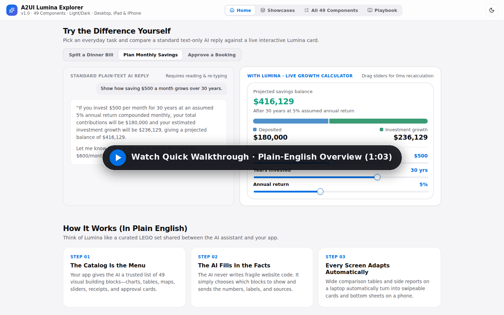
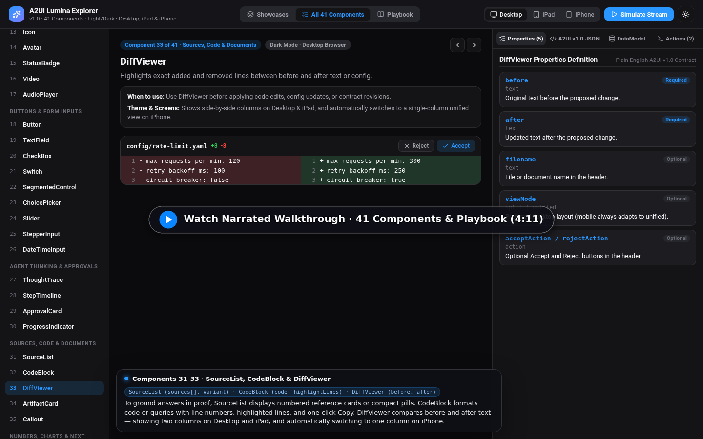

# A2UI Lumina — Visual Building Blocks for AI Assistants

Most AI assistants still answer everything with long walls of paragraphs. **A2UI Lumina** gives AI a trusted menu of **49 ready-made visual building blocks**—so assistants can reply with interactive charts, street maps, calculators, bill splitters, and one-tap approval buttons that adapt automatically across **Desktop, Tablet, and Phone** in both Light and Dark mode.

**[▶ Watch Quick Tour](#quick-walkthrough)** · **[📖 Plain-English Playbook](docs/PLAYBOOK.md)** · **[🧩 All 49 Building Blocks](#whats-inside-the-catalog)** · **[⚡ Try Live Demo Locally](#try-it-locally)**

---

## Key Facts at a Glance

| Highlight | What It Means |
| :--- | :--- |
| **49 Visual Building Blocks** | Ready-made cards, charts, maps, labeled diagrams, sliders, split bills, side reports & approval gates |
| **24 Instant Helpers** | Live on-screen math, currency/date formatting, and safety checks with zero waiting |
| **1 Reply, Every Screen** | Automatically adapts layouts across Desktop, iPad, and iPhone in both Light and Dark mode |
| **Safe by Design (`A2UI v1.0`)** | AI sends plain data—never fragile raw code—built in React today and ready for iOS, Android, Angular & Flutter |

---

## Quick Walkthrough

New here? Watch our **1-minute plain-English overview (`1:03` · Voiceover)** showing how Lumina turns text-heavy AI answers into interactive cards, live sliders, verifiable sources, human approval gates, and synchronized laptop + phone layouts:

<video src="docs/media/lumina-quick-walkthrough-narrated.mp4" poster="docs/media/poster-quick-walkthrough.png" controls width="100%">
  <a href="docs/media/lumina-quick-walkthrough-narrated.mp4">
    
  </a>
</video>

> **[▶ Open Quick Walkthrough (`1:03` · MP4 with Voiceover)](docs/media/lumina-quick-walkthrough-narrated.mp4)** · **[Direct Raw Stream](docs/media/lumina-quick-walkthrough-narrated.mp4?raw=1)**

### Want a Deeper Look?

| [](docs/media/lumina-hero-agent-studio-narrated.mp4?raw=1) | [](docs/media/lumina-openai-intelligent-ui-sxs-narrated.mp4?raw=1) | [](docs/media/lumina-components-deep-dive-narrated.mp4?raw=1) |
| :--- | :--- | :--- |
| **[Web × Mobile Live Studio (`1:55`)](docs/media/lumina-hero-agent-studio-narrated.mp4?raw=1)**<br/>4 real workflows running on laptop and phone side by side from one stream. | **[ChatGPT UI Side-by-Side (`2:54`)](docs/media/lumina-openai-intelligent-ui-sxs-narrated.mp4?raw=1)**<br/>8 flagship interactive UIs (Roth IRA, Dinner Split, SF Route, Bicycle) rebuilt with Lumina. | **[Component & Playbook Tour (`4:11`)](docs/media/lumina-components-deep-dive-narrated.mp4?raw=1)**<br/>Property definitions, Light/Dark themes, device adaptation, and the [Playbook](docs/PLAYBOOK.md) · [Mobile Clip (`0:09`)](docs/media/lumina-studio-mobile.mp4?raw=1) |

---

## How It Works in 30 Seconds

Think of Lumina like a curated LEGO set shared between an AI assistant and your app:

1. **The Catalog Is the Menu:** Instead of letting an AI invent messy website code from scratch, your app gives it a trusted menu of **49 tested building blocks**.
2. **The AI Fills In the Facts:** The AI picks the right blocks for the job and sends plain numbers, labels, and sources—keeping every screen fast, consistent, and safe.
3. **Every Device Adapts Automatically:** Side-by-side comparison tables and split-screen reports on a laptop automatically turn into swipeable cards and draggable bottom sheets on a phone.

---

## What’s Inside the Catalog

All **49 building blocks** are organized around **6 everyday jobs**:

| Everyday Job | Count | What People Can Do |
| :--- | :---: | :--- |
| **Numbers, Charts & Comparisons** | 9 | Scan headline KPIs with mini trendlines, inspect charts, sort tables, compare options side by side, split group bills, or take quick quizzes |
| **Taps, Sliders & Quick Inputs** | 10 | Drag budget sliders, count guests with `+/−` steppers, pick color swatches, flip switches, or choose dates without typing |
| **Maps, Diagrams & Media** | 9 | Explore multi-stop street routes, click labeled diagram pins, zoom into images, or play inline audio and video |
| **Progress & Human Sign-Off** | 5 | Expand how the AI reasoned, follow live step trackers, check off runbooks, and lock high-stakes actions behind human approval |
| **Sources, Side Docs & Previews** | 6 | Verify clickable web citations, open long reports in a clean side panel, review before/after text changes, or run sandboxed mini-canvases |
| **Clean Layouts & Containers** | 10 | Organize answers into responsive grids, swipeable carousels, tabs, collapsible sections, and mobile bottom sheets |

<details>
<summary><strong>🔍 View all 49 developer component names &amp; 24 built-in functions</strong></summary>

<br/>

| Family | Count | Component Names |
| :--- | :---: | :--- |
| **Layout & Containers** | 10 | `Row`, `Column`, `Grid`, `List`, `Carousel`, `Card`, `Tabs`, `Accordion`, `Modal`, `Divider` |
| **Text, Media & Identity** | 9 | `Text`, `Image`, `Icon`, `Avatar`, `StatusBadge`, `Video`, `AudioPlayer`, `AnnotatedDiagram`, `RouteMap` |
| **Buttons & Form Inputs** | 10 | `Button`, `TextField`, `CheckBox`, `Switch`, `SegmentedControl`, `ChoicePicker`, `Slider`, `StepperInput`, `DateTimeInput`, `SwatchPicker` |
| **Agent Thinking & Approvals** | 5 | `ThoughtTrace`, `StepTimeline`, `ApprovalCard`, `ProgressIndicator`, `ChecklistCard` |
| **Sources, Code & Documents** | 6 | `SourceList`, `CodeBlock`, `DiffViewer`, `ArtifactCard`, `Callout`, `MicroApp` |
| **Numbers, Charts & Next Steps** | 9 | `StatMetric`, `Chart`, `DataTable`, `KeyValueList`, `ComparisonMatrix`, `FollowUpSuggestions`, `ProportionBar`, `QuizCard`, `SplitLedger` |

**Client-Side Catalog Functions (24):**
- **14 Standard A2UI v1.0 Functions:** `required`, `regex`, `length`, `numeric`, `email`, `and`, `or`, `not`, `formatString`, `formatNumber`, `formatCurrency`, `formatDate`, `pluralize`, `openUrl` ( preserves 100% compatibility with all 43 upstream A2UI v1.0 Basic Catalog golden examples).
- **10 Lumina Reactive Math & UX Functions:** `formatCompactNumber`, `formatPercent`, `formatRelativeTime`, `copyToClipboard`, `shareContent`, `setValue`, `computeMath`, `compoundGrowth`, `selectByValue`, `sampleDistribution`.

</details>

---

## Try It Locally

**Prerequisites:** Node.js `>= 22` and `pnpm` (no API key needed—runs out of the box in instant **Replay Mode**, or connects to live Gemini when `GEMINI_API_KEY` is set).

```bash
pnpm install && pnpm build
pnpm dev
```

Running `pnpm dev` opens:
- **Home Page, Component Explorer & Playbook (`http://localhost:5173`):** Friendly visual tour, live *Plain Text vs. Lumina* playground, all 49 interactive components across Light/Dark & Desktop/iPad/iPhone, and the 5-recipe Playbook.
- **Hero Agent Studio (`http://localhost:5174`):** Multi-turn conversational showcase featuring **Web × Mobile Side-by-Side (`SxS`)** and **ChatGPT Intelligent UI × Lumina SxS** views.

<details>
<summary><strong>⚛️ Minimal React Integration (<code>&lt;LuminaSurface /&gt;</code>) &amp; Verification Commands</strong></summary>

<br/>

```tsx
import { MessageProcessor } from '@a2ui/web_core';
import type { ReactCatalogComponent } from '@a2ui/react';
import { LUMINA_V1_CATALOG_ID, processLuminaMessages } from '@a2ui-catalog/core';
import { LuminaProvider, LuminaSurface, luminaReactCatalog } from '@a2ui-catalog/react';
import '@a2ui-catalog/tokens/styles.css';
import '@a2ui-catalog/react/styles.css';

const processor = new MessageProcessor<ReactCatalogComponent>([luminaReactCatalog], (action) => {
  console.log('User dispatched action:', action);
});

processLuminaMessages(processor, [
  {
    version: '1.0',
    createSurface: {
      surfaceId: 'summary',
      catalogId: LUMINA_V1_CATALOG_ID,
      components: [
        { id: 'root', component: 'StatMetric', label: 'Active Users', value: '28,400', delta: '+14%', trend: 'up' },
      ],
    },
  },
]);

const surface = processor.model.surfacesMap.get('summary')!;
// Render: <LuminaProvider theme="light"><LuminaSurface surface={surface} /></LuminaProvider>
```

```bash
# Isolated per-component fixture preview
./scripts/worktree-preview.sh

# Full verification gate (typecheck, lint/DAG boundaries, doc links, unit/contract tests, catalog.json build)
./scripts/verify.sh
```

</details>

<details>
<summary><strong>🗂️ Multi-Platform Architecture &amp; Repository Layout</strong></summary>

<br/>

Normative schemas ([`packages/schema/catalog.json`](packages/schema/catalog.json) + `@a2ui-catalog/core`) have **zero React or DOM dependencies**, and W3C design tokens (`@a2ui-catalog/tokens`) emit CSS custom properties alongside Swift, Kotlin, and Dart token stubs so **Angular, Flutter, iOS (SwiftUI), and Android (Jetpack Compose)** share one protocol contract.

| Path | Role |
| :--- | :--- |
| [`src/protocol/`](src/protocol/) | Layer 0: Framework-free A2UI v1.0 constants, Zod `Dynamic*` helpers, wire normalizer, and slice descriptors |
| [`src/primitives/`](src/primitives/) | Layer 0.5: Shared UI primitives (`AdaptiveOverlay`, icon registry, motion springs, safe value readers) |
| [`src/components/`](src/components/) | Layer 1A: **49 vertical component slices** (`schema.ts`, `prompt.md`, `examples.json`, `renderer.tsx`, `index.ts`, `<slug>.test.tsx`) |
| [`src/functions/`](src/functions/) | Layer 1B: **9 vertical function slices** (`basic-v1` + 10 Lumina client functions) |
| [`src/catalog/`](src/catalog/) | Layer 2: Canonical `catalogRegistry`, `catalog.json` compiler, domain profile slicer, and React adapter |
| [`src/preview/`](src/preview/) | Layer 3: Isolated worktree-safe Vite preview harness mounting every component's `examples.json` fixtures |
| [`packages/tokens/`](packages/tokens/) | `@a2ui-catalog/tokens` — W3C design tokens compiled to CSS variables, TS springs, and Swift/Kotlin/Dart stubs |
| [`packages/core/`](packages/core/) | `@a2ui-catalog/core` — Framework-free projection of A2UI v1.0 component schemas, functions, and profiles |
| [`packages/schema/`](packages/schema/) | `@a2ui-catalog/schema` — Compiled Draft 2020-12 `catalog.json` + Ajv & Basic v1.0 conformance suite |
| [`packages/react/`](packages/react/) | `@a2ui-catalog/react` — React renderer (`LuminaProvider`, `LuminaSurface`, `luminaReactCatalog`) + stylesheet |
| [`apps/explorer/`](apps/explorer/) | Friendly Home Page, interactive 49-component visual workbench, property inspector, and plain-English Playbook |
| [`apps/studio/`](apps/studio/) | Conversational Hero Agent showcase with Web × Mobile + OpenAI Intelligent UI Side-by-Side (`SxS`) views |
| [`apps/agent/`](apps/agent/) | A2A v1.0 SSE agent backend supporting deterministic Replay mode and live `@google/genai` Gemini mode |

</details>

---

## Where to Read Next

- **Product Managers, Designers & Newcomers:** [Practical Component Playbook (`docs/PLAYBOOK.md`)](docs/PLAYBOOK.md) · [Plain-English Glossary (`docs/GLOSSARY.md`)](docs/GLOSSARY.md)
- **Application & Agent Engineers:** [Component & Function Specification (`docs/COMPONENT_CATALOG_SPEC.md`)](docs/COMPONENT_CATALOG_SPEC.md) · [Normative v1.0 Spec (`docs/specs/0001-lumina-v1-catalog-spec.md`)](docs/specs/0001-lumina-v1-catalog-spec.md)
- **Design System & Multi-Platform Engineers:** [Technical Design (`docs/DESIGN.md`)](docs/DESIGN.md) · [Platform Extension Guide (`docs/PLATFORM_EXTENSION_GUIDE.md`)](docs/PLATFORM_EXTENSION_GUIDE.md)
- **Contributors & Coding Agents:** [Architecture & Layering (`ARCHITECTURE.md`)](ARCHITECTURE.md) · [Component Health Scorecard (`docs/QUALITY_SCORE.md`)](docs/QUALITY_SCORE.md) · [ADR 0001 (`docs/adr/0001-vertical-deep-modules.md`)](docs/adr/0001-vertical-deep-modules.md) · [Implementation Plan (`docs/IMPLEMENTATION_PLAN.md`)](docs/IMPLEMENTATION_PLAN.md) · [Tech-Debt Tracker (`docs/exec-plans/tech-debt-tracker.md`)](docs/exec-plans/tech-debt-tracker.md) · [Agent Entry Point (`AGENTS.md`)](AGENTS.md)
