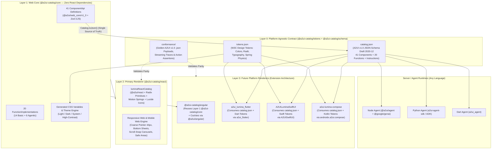
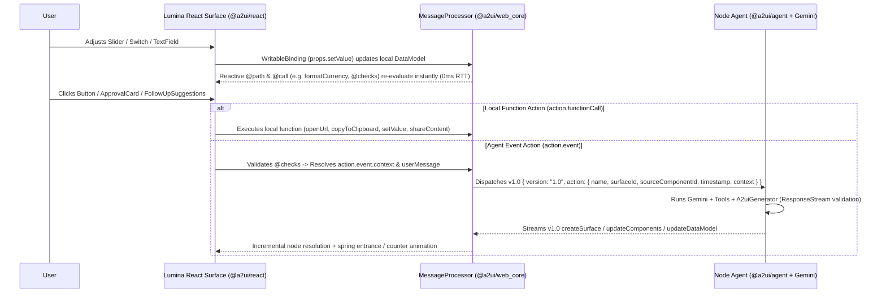

# A2UI Lumina Catalog — Technical Design Document

**Status:** Approved for Implementation  
**Protocol Target:** A2UI Specification `v1.0` (`protocolVersion: "1.0"`)  
**Primary Target:** React (`react-dom` >= 18/19) across Desktop Web, Mobile Web, and Embedded WebViews  
**Extensibility Targets:** Angular (`@a2ui/angular`), Lit (`@a2ui/lit`), Flutter (`a2ui_flutter`), iOS (`A2UISwiftUI`), Android (`androidx.a2ui.compose`), React Native  
**Canonical Catalog ID:** `https://wsyang0309.github.io/a2ui-catalog/specification/v1_0/lumina/catalog.json`

---

## 1. Executive Summary & Product Vision

**A2UI (Agent-to-User Interface)** enables AI agents to stream safe, declarative, native user interfaces as flat JSON component graphs without emitting raw HTML, CSS, or arbitrary executable scripts. While the official A2UI **Basic Catalog (`v1.0`)** provides 18 foundational primitives and 14 helper functions intended as a minimal reference for protocol experimentation, it lacks the higher-order building blocks, rich data presentations, human-in-the-loop (HITL) controls, grounding primitives, and tactile polish that users expect from modern AI products like **ChatGPT's Intelligent UI** (Search, Canvas, Deep Research, Operator) and **Apple's Human Interface Guidelines** (iOS 18, macOS Sequoia, Apple Intelligence, Apple Wallet).

**A2UI Lumina (`@a2ui-catalog/*`)** is a unified, production-grade **A2UI v1.0 Component Catalog** built first in React for Web and Mobile Web, architected from day one so its schema contract, design tokens, and conformance test suite extend cleanly to Angular, Flutter, SwiftUI, and Jetpack Compose.

### 1.1 Core Design Guardrails & Non-Goals

> [!IMPORTANT]
> **Agentic UI Building Blocks — NOT a General Web Framework.**  
> Lumina exists exclusively to express rich **agent-to-user turns, workspaces, artifacts, data syntheses, and interactive approvals**. Every component earns its place in the LLM system prompt by replacing fragile, verbose nested `Row`/`Column` trees with a single semantic, high-signal schema.

| In Scope (Agentic UI Building Blocks) | Explicitly Out of Scope (Web-App Chrome) |
| :--- | :--- |
| Reasoning traces (`ThoughtTrace`), multi-step tool execution (`StepTimeline`), and live progress (`ProgressIndicator`) | Marketing hero banners, mega-menus, top navigation bars, site footers, breadcrumbs |
| Human-in-the-loop high-stakes gates (`ApprovalCard`) with input validation (`@checks`) | Cookie consent banners, SEO metadata blocks, full-page CMS layout grids |
| Grounded citations (`SourceList`), code & patch inspection (`CodeBlock`, `DiffViewer`), and expandable deliverables (`ArtifactCard`) | Complex WYSIWYG rich-text editors, spreadsheet formula engines, CAD canvases |
| Structured synthesis (`StatMetric`, `Chart`, `DataTable`, `KeyValueList`, `ComparisonMatrix`) | Arbitrary CSS utility props (`marginTop`, `paddingLeft`, raw hex strings) exposed to the LLM |
| Tactile micro-forms (`SegmentedControl`, `Switch`, `StepperInput`, `ChoicePicker`, `Slider`) and conversational `FollowUpSuggestions` | Hundreds of atomic HTML wrapper components that bloat prompt context and degrade LLM schema accuracy |

---

## 2. Gap Analysis: A2UI v1.0 Basic Catalog vs. Agentic Applications

### 2.1 Audit of the Official Basic Catalog (`v1.0`)

The upstream Basic Catalog (`catalogs/basic/v1/catalog.json`, `https://a2ui.org/specification/v1_0/catalogs/basic/catalog.json`) defines **18 components** and **14 functions**:

- **Layout (7):** `Row`, `Column`, `List`, `Card`, `Tabs`, `Modal`, `Divider`
- **Display & Media (5):** `Text`, `Image`, `Icon`, `Video`, `AudioPlayer`
- **Inputs (6):** `Button`, `TextField`, `CheckBox`, `ChoicePicker`, `Slider`, `DateTimeInput`
- **Functions (14):** `required`, `regex`, `length`, `numeric`, `email`, `formatString`, `formatNumber`, `formatCurrency`, `formatDate`, `pluralize`, `openUrl`, `and`, `or`, `not`

### 2.2 Six Critical Gaps Addressed by Lumina

| Gap Area | Failure Mode in Basic Catalog | Lumina Solution |
| :--- | :--- | :--- |
| **1. Agentic Transparency & HITL** | Agents cannot show collapsible chain-of-thought, live tool progress, or structured approval gates without ad-hoc `Column` + `Text` hacks that lack state transitions. | `ThoughtTrace`, `StepTimeline`, `ApprovalCard`, `ProgressIndicator` |
| **2. Grounding, Code & Artifacts** | `Text` supports basic Markdown, but lacks clickable favicon citation rails, syntax-highlighted copyable code blocks, unified/split code diffs, or Canvas-style artifact preview cards. | `SourceList`, `CodeBlock`, `DiffViewer`, `ArtifactCard`, `Callout` |
| **3. Structured Synthesis & Charts** | Representing a 4-column comparison, a receipt/booking summary, KPI sparklines, or an interactive chart forces the LLM to emit 50–120 deeply nested `Row`/`Column`/`Text` nodes—wasting tokens and breaking on mobile screens. | `StatMetric`, `Chart`, `DataTable`, `KeyValueList`, `ComparisonMatrix` |
| **4. Layout & Conversational Flow** | Missing responsive 2D bento grids (`Grid`), touch-swipeable horizontal rails (`Carousel`), collapsible sections (`Accordion`), semantic pills (`StatusBadge`, `Avatar`), and post-turn quick replies (`FollowUpSuggestions`). | `Grid`, `Carousel`, `Accordion`, `StatusBadge`, `Avatar`, `FollowUpSuggestions` |
| **5. Tactile Mobile-Ready Inputs** | Missing iOS-grade spring `Switch`, sliding-pill `SegmentedControl`, and `- / +` numeric `StepperInput` (ubiquitous in booking, travel, and commerce turns); `Modal` does not adapt to a draggable mobile bottom sheet. | `Switch`, `SegmentedControl`, `StepperInput`, upgraded `Modal` (adaptive Bottom Sheet), upgraded `TextField` & `ChoicePicker` |
| **6. Cohesive Visual & Motion Fidelity** | Mixing custom modern components with upstream Basic Catalog Lit elements produces jarring visual seams ("Frankenstein UI"), static pops during streaming, and inconsistent typography/dark mode. | **Unified Full Catalog** restyling all 18 Basic Catalog components to exact schema parity + 23 net-new agentic components under one Apple/ChatGPT design system. |

### 2.3 Unified Catalog Strategy & Backward Compatibility

Lumina implements the **Unified Full Catalog** pattern while supporting A2UI v1.0 multi-catalog composition:

1. **100% Superset Compatibility with Basic Catalog v1.0:** Every one of the 18 Basic Catalog components (`Row`, `Column`, `List`, `Card`, `Tabs`, `Modal`, `Divider`, `Text`, `Image`, `Icon`, `Video`, `AudioPlayer`, `Button`, `TextField`, `CheckBox`, `ChoicePicker`, `Slider`, `DateTimeInput`) and all 14 Basic Catalog functions are included in Lumina with backward-compatible required and optional property contracts. Any valid v1.0 Basic Catalog surface renders in Lumina simply by targeting Lumina's `catalogId` (or registering Lumina under a Basic Catalog alias when desired).
2. **A2UI v1.0 Multi-Catalog Mixing (`@catalogId`):** Because Lumina is built natively on `@a2ui/web_core` v1.0 and `@a2ui/react`, surfaces can also mix Lumina components with external specialized catalogs (such as `@a2ui/catalog-mcp` or `@a2ui/catalog-vegachart`) using per-component `@catalogId` and per-call `catalogId`.
3. **Domain Profile Slicing for Prompt Efficiency:** In addition to the full 41-component catalog, `@a2ui-catalog/core` exports `createLuminaCatalogSlice(profile)` built on `Catalog.copyWith(...)` (`core`, `research`, `commerce`, `devops`, `analytics`) so latency-sensitive or small-context agents can advertise only relevant subsets in their LLM prompt while the client renderer registers the complete Lumina catalog.

---

## 3. Multi-Platform Architecture

To satisfy immediate Web + Mobile Web excellence in React while guaranteeing clean future expansion to **Angular, Flutter, iOS (SwiftUI), Android (Jetpack Compose), and React Native**, the repository is strictly layered into **4 architectural tiers**.

### 3.1 How Cross-Platform Extension Works Without Rewriting Contracts

1. **Schema Single Source of Truth (`@a2ui-catalog/core` -> `catalog.json`):**  
   All 41 component schemas and 20 function signatures are authored once in `@a2ui-catalog/core` using `@a2ui/web_core/v1_0` schema helpers (`dynamicString`, `dynamicNumber`, `dynamicBoolean`, `dynamicValue`, `dynamicStringList`, `componentId`, `childList`, `Checkable`, `Action`) with `zod@^3.25.76`. A build script invokes `Catalog.toJson()` to emit the canonical A2UI v1.0 `catalog.json` and validates it against upstream `specification/v1_0/json/catalog_definition.json`.
2. **Direct TypeScript Reuse for Angular & Lit:**  
   Because `@a2ui-catalog/core` has **zero React imports**, an Angular implementation (`@a2ui-catalog/angular`) imports the exact `ComponentApi` objects, `LUMINA_FUNCTIONS`, and `@a2ui-catalog/tokens/styles.css` directly, implementing thin `CatalogComponent<typeof Api>` views in `@a2ui/angular`. Furthermore, `@a2ui/react`'s Web Component bridge (`to_web_component`) can wrap any React component as a Custom Element for incremental migration in web hosts.
3. **Token & Physics Translation for Flutter, iOS (SwiftUI), and Jetpack Compose:**  
   `@a2ui-catalog/tokens` defines all visual and motion tokens in platform-neutral W3C Design Token JSON (`tokens/src/*.tokens.json`), including physical spring constants (`mass`, `stiffness`, `damping`) rather than CSS-only cubic-beziers:
   - **Web / React:** Compiles to CSS Custom Properties (`--lumina-*`) + Motion spring configs `{ type: "spring", mass, stiffness, damping }`.
   - **iOS / SwiftUI:** Compiles via token emitter to `Color` asset definitions and `Animation.interpolatingSpring(mass:stiffness:damping:)`.
   - **Android / Jetpack Compose:** Compiles to `LuminaColorScheme`, `LuminaTypography`, and `spring(dampingRatio = ..., stiffness = ...)`.
   - **Flutter:** Compiles to `LuminaThemeExtension` and `SpringDescription(mass: ..., stiffness: ..., damping: ...)`.
4. **Cross-Platform Conformance Suite (`packages/schema/conformance/`):**  
   Every component has framework-agnostic JSON test vectors (initial surface, incremental `updateDataModel` mutations, validation failures, and expected outbound `action` payloads). Any future platform renderer achieves certification by passing the same fixture suite.

---

## 4. A2UI v1.0 Protocol Architecture & Compliance

### 4.1 Wire Protocol Contract (`v1.0`)

Lumina strictly targets **A2UI v1.0** (`"version": "1.0"` on wire messages, `"protocolVersion": "1.0"` in `catalog.json`):

- **Capabilities Negotiation:** Client sends `a2uiRendererCapabilities: { "1.0": { "supportedCatalogIds": [LUMINA_CATALOG_ID, BASIC_V1_CATALOG_ID] } }` in A2A message metadata.
- **Surface Lifecycle Messages:** `createSurface`, `updateComponents`, `updateDataModel`, `deleteSurface`.
- **v1.0 `@`-Prefixed Envelope Directives:**
  - `@catalogId`: Per-component catalog override on multi-catalog surfaces.
  - `@accessibility`: `{ label?: DynamicString, description?: DynamicString }` bound via `@a2ui/react`'s `accessibilityRef` to the interactive DOM element.
  - `@metadata`: Arbitrary component metadata preserved through `NodeResolver`.
  - `@checks`: Array of `{ condition: DataBinding | FunctionCall, message?: string }` rules evaluated reactively on `Checkable` components; error lists bind to `validationErrorsRef` with automatic `aria-invalid` and `aria-describedby`.
- **v1.0 Dynamic Value AST:**
  - Literal values (`"Book Flight"`, `42`, `true`, `["a", "b"]`)
  - Data Model Pointers (`{ "@path": "/booking/partySize" }` for root paths, `{ "@path": "price" }` for relative item paths inside `TemplateChildList`)
  - Function Calls (`{ "@call": "formatCurrency", "args": { "value": { "@path": "/total" }, "currency": "USD" } }`, plus `{ "@call": "@index", "args": { "offset": 1 } }` inside `TemplateChildList`)
- **Flat Topology & Slot References:**
  - Components are NEVER nested as inline JSON trees. Every component lives in the surface's flat `components` array with a unique `id` (`"root"` for the top-level node) and references children strictly via `ComponentId` (`string`) or `ChildList` (`string[]` or `{ componentId: string, path: string }` `TemplateChildList`).
  - Container components render children exclusively via `@a2ui/react`'s `buildChild(childId, basePath)` to preserve reactive data-context scoping and template item paths.

### 4.2 Bidirectional State & Actions

### 4.3 Critical Ecosystem Constraint: Zod 3 Pinning

> [!WARNING]
> **Pin `zod` to `^3.25.76` across the entire TypeScript workspace.**  
> Upstream `@a2ui/web_core` and `@a2ui/agent` rely on Zod 3 internal AST reflection to convert `ComponentApi` schemas into JSON Schema Draft 2020-12 documents for LLM prompts and payload validation. Do **not** install `@google/adk` (which pulls `zod@^4.x` and breaks at runtime); use `@google/genai` directly in the Node agent server, matching A2UI's official v1.0 Node sample architecture.

---

## 5. Visual Design System & Motion Language ("Apple HIG × ChatGPT Intelligent UI")

Lumina's aesthetic fuses **ChatGPT's calm, high-signal conversational clarity** (effortless inline widgets, soft neutral cards, crisp citations, intelligent reasoning accordions) with **Apple's tactile industrial craft** (optical corner concentricity, translucent materials, spring physics, tabular numerals, and flawless dark mode).

### 5.1 Color & Surface Architecture ("Alabaster & Obsidian")

All components consume semantic CSS Custom Properties scoped under `[data-lumina-theme="light" | "dark"]` (defaulting automatically to `prefers-color-scheme` with programmatic override support):

| Semantic Token | Light Mode ("Alabaster") | Dark Mode ("Obsidian") | Usage |
| :--- | :--- | :--- | :--- |
| `--lumina-bg-surface` | `#FFFFFF` | `#141417` | Primary `Card`, `ArtifactCard`, `DataTable` surface |
| `--lumina-bg-elevated` | `#F7F7F9` | `#1C1C21` | Grouped inset surface (`KeyValueList` container, `CodeBlock`, `ThoughtTrace`) |
| `--lumina-bg-subtle` | `#EFEFF4` | `#26262D` | Inactive `SegmentedControl` track, chip fill, hover states |
| `--lumina-bg-glass` | `rgba(255, 255, 255, 0.78)` | `rgba(24, 24, 29, 0.76)` | `Modal`, Mobile `BottomSheet`, `Carousel` floating controls (`backdrop-filter: blur(22px) saturate(180%)`) |
| `--lumina-fg-primary` | `#0D0D0F` | `#F5F5F7` | Primary headings, KPI values, active controls |
| `--lumina-fg-secondary` | `#5E5E66` | `#A1A1AA` | Supporting prose, descriptions, table headers |
| `--lumina-fg-tertiary` | `#8E8E93` | `#6E6E77` | Timestamps, placeholders, axis labels, disabled text |
| `--lumina-border-hairline` | `rgba(0, 0, 0, 0.07)` | `rgba(255, 255, 255, 0.09)` | Crisp `1px` structural borders + dark-mode top specular highlight |
| `--lumina-accent-primary` | `#0071E3` | `#2997FF` | Primary CTA `Button`, active selection ring, primary chart series |
| `--lumina-accent-agent` | `#5E5CE6` | `#7D7AFF` | Active reasoning shimmer (`ThoughtTrace`, active `StepTimeline` node) |
| `--lumina-tone-success` | `#10A37F` | `#30D158` | Positive delta pills, approved state, completed steps |
| `--lumina-tone-warning` | `#D97706` | `#FF9F0A` | Medium-risk `ApprovalCard`, warning `Callout` / `StatusBadge` |
| `--lumina-tone-critical` | `#E11D48` | `#FF453A` | Destructive `ApprovalCard`, error `@checks`, negative delta |

### 5.2 Typography, Optical Concentricity & Tabular Numerals

- **Font Stack:**
  - Sans: `--lumina-font-sans: -apple-system, BlinkMacSystemFont, "SF Pro Text", "SF Pro Display", "Inter", system-ui, sans-serif`
  - Mono: `--lumina-font-mono: "SF Mono", "JetBrains Mono", ui-monospace, SFMono-Regular, Menlo, monospace`
- **Optical Corner Concentricity (Apple HIG Rule):** Outer containers use `--lumina-radius-xl` (`20px`), inner cards use `--lumina-radius-lg` (`14px`), and nested buttons/inputs use `--lumina-radius-md` (`10px`), ensuring `R_outer - padding ≈ R_inner` so nested corners never look pinched.
- **Zero-Jitter Tabular Numerals:** `font-variant-numeric: tabular-nums lining-nums` is enforced on `StatMetric`, `Chart` tooltips/axes, `DataTable` numeric cells, `StepperInput`, `Slider` value readouts, `ProgressIndicator`, and `ThoughtTrace` elapsed timers.

### 5.3 Interactive Spring Physics & Streaming Choreography

Lumina uses `motion` (`motion/react`) paired with GPU-composited transforms (`transform`, `opacity`, `clip-path`, `filter`) standardized on **four physical spring curves**:

1. **`springTactile` (`{ type: "spring", stiffness: 520, damping: 34, mass: 0.75 }`):**  
   Used on `Button` press (`scale: 0.97`), `Switch` thumb travel, `StepperInput` tap feedback, `FollowUpSuggestions` hover/tap lift, and `SegmentedControl` / `Tabs` shared-layout `layoutId` pill glide.
2. **`springFluid` (`{ type: "spring", stiffness: 360, damping: 32, mass: 0.95 }`):**  
   Used on `Accordion`, `ThoughtTrace` body disclosure, `ApprovalCard` state transition (actionable -> approved/rejected receipt), and `ArtifactCard` expansion.
3. **`springSheet` (`{ type: "spring", stiffness: 400, damping: 38, mass: 1.0 }`):**  
   Used on `Modal` dialog entrance and Mobile `BottomSheet` drag-to-dismiss snap points with touch velocity projection.
4. **Incremental Streaming Entrance & Live Value Interpolation:**  
   - When an agent streams `updateComponents` over SSE, newly mounted components enter with a subtle, non-distracting `180ms` fade-and-unblur (`opacity: 0 -> 1`, `translateY: 6px -> 0`, `filter: blur(3px) -> blur(0px)`), staggered by `35ms` for `List`, `Grid`, `StepTimeline`, and `FollowUpSuggestions`.
   - When `updateDataModel` mutates numeric metrics, `StatMetric` and `ProgressIndicator` smoothly interpolate from previous to next value over `350ms` instead of snapping abruptly.
   - **Accessibility Respect:** When `prefers-reduced-motion: reduce` is active, spatial translations, blurs, and spring bounces automatically collapse to instant `120ms` opacity crossfades.

### 5.4 Web & Mobile Dual-Ergonomics

Every component in `@a2ui-catalog/react` is engineered simultaneously for **Desktop mouse/keyboard** and **Mobile touch/WebView** without requiring the agent to know the user's screen size:

| Ergonomic Dimension | Desktop Web (`>= 768px`, fine pointer) | Mobile Web / WebView (`< 768px` or `pointer: coarse`) |
| :--- | :--- | :--- |
| **Touch Target Minimum** | `34px–38px` compact density | `>= 44px × 44px` enforced via `@media (pointer: coarse)` hit-area expansion |
| **`Modal` Presentation** | Centered frosted glass dialog (`max-width: 520px`) with `Esc` close & focus trap | **iOS-style Draggable Bottom Sheet** anchored to viewport bottom with grabber handle, swipe-down dismiss, and `padding-bottom: env(safe-area-inset-bottom)` |
| **`Carousel` & `SourceList`** | Smooth horizontal scroll with hover-revealed blurred Previous/Next chevron pills | Native 120fps touch momentum scrolling with `scroll-snap-type: x mandatory` |
| **`Grid` & `ComparisonMatrix`** | Multi-column CSS Grid (`2–4` columns) | Automatic responsive collapse (`1–2` columns) or sticky-header horizontal snap cards |
| **`Chart` Inspection** | Mouse hover crosshair + floating glass tooltip | Touch-and-drag scrub gesture across data points without hijacking vertical page scroll |
| **`DataTable`** | Full column table with sticky header & sort controls | Sticky primary column + smooth horizontal scroll container with subtle edge-fade masks |

---

## 6. Component & Function Taxonomy Overview

Lumina defines **41 components** (18 upgraded Basic Catalog components + 23 net-new agentic components) and **20 renderer functions** (14 Basic Catalog functions + 6 net-new agentic functions). Full property-by-property JSON Schema definitions are specified in [`COMPONENT_CATALOG_SPEC.md`](file:///home/antigravity/wsyang0309/a2ui-catalog/docs/COMPONENT_CATALOG_SPEC.md).

### 6.1 Component Matrix (41 Components)

| Category | Upgraded Basic Catalog Primitives (18) | Net-New Agentic Primitives (23) |
| :--- | :--- | :--- |
| **1. Layout & Containers (10)** | `Row`, `Column`, `List`, `Card`, `Tabs`, `Modal` *(adaptive Bottom Sheet)*, `Divider` | `Grid` *(responsive bento)*, `Carousel` *(swipeable snap rail)*, `Accordion` *(progressive disclosure)* |
| **2. Typography, Media & Identity (7)** | `Text` *(Markdown + optical ramp)*, `Image` *(skeleton + zoom)*, `Icon`, `Video`, `AudioPlayer` | `StatusBadge` *(semantic pill + pulse)*, `Avatar` *(user/agent/brand + status dot)* |
| **3. Tactile Inputs & Controls (9)** | `Button`, `TextField`, `CheckBox`, `ChoicePicker`, `Slider`, `DateTimeInput` | `Switch` *(iOS spring toggle)*, `SegmentedControl` *(sliding pill)*, `StepperInput` *(`- / +` counter)* |
| **4. Agentic Reasoning & HITL (4)** | — | `ThoughtTrace`, `StepTimeline`, `ApprovalCard`, `ProgressIndicator` |
| **5. Grounding, Code & Artifacts (5)** | — | `SourceList` *(citations & web cards)*, `CodeBlock`, `DiffViewer`, `ArtifactCard`, `Callout` |
| **6. Data Synthesis & Conversation (6)** | — | `StatMetric` *(KPI + sparkline)*, `Chart` *(line/area/bar/donut)*, `DataTable`, `KeyValueList`, `ComparisonMatrix`, `FollowUpSuggestions` |

### 6.2 Renderer Functions (20 Functions)

- **Inherited A2UI v1.0 Basic Functions (14):** `required`, `regex`, `length`, `numeric`, `email`, `formatString`, `formatNumber`, `formatCurrency`, `formatDate`, `pluralize`, `openUrl`, `and`, `or`, `not` (re-exported directly from `@a2ui/web_core/v1_0`).
- **New Lumina Agentic Functions (6):**
  1. `formatCompactNumber(value, decimals?)` -> `string` (e.g., `1420000` -> `"1.4M"`)
  2. `formatPercent(value, decimals?, includeSign?)` -> `string` (e.g., `0.124` -> `"+12.4%"`)
  3. `formatRelativeTime(isoDate)` -> `string` (e.g., `"2m ago"`, `"in 4 hours"`)
  4. `copyToClipboard(text, label?)` -> `void` (`requiresUserActivation: true`; triggers subtle floating "Copied" pill)
  5. `shareContent(title, text?, url?)` -> `boolean` (`requiresUserActivation: true`; invokes mobile Web Share API with clipboard fallback)
  6. `setValue(path, value)` -> `void` (`allowedCallers: "rendererOnly"`; mutates surface `DataModel` locally for zero-latency client interactions)

---

## 7. Testing Infrastructure Reuse & Live Hero Agent Showcase

Rather than inventing bespoke testing harnesses, Lumina directly adopts and extends the testing and sample infrastructure patterns from [`a2ui-project/a2ui`](https://github.com/a2ui-project/a2ui):

### 7.1 Four-Layer Verification & Demo Stack

1. **A2UI v1.0 Specification Schema Conformance (`packages/schema/tests/`):**
   - Validates generated `catalog.json` against upstream `specification/v1_0/json/catalog_definition.json` using `ajv` (Draft 2020-12), mirroring `specification/v1_0/test/run_tests.py`.
   - Validates every golden example and stub agent turn against `specification/v1_0/json/agent_to_renderer.json` and `@a2ui/web_core`'s `PayloadValidator`.
2. **React Surface Unit & Basic-Catalog Compatibility Suite (`packages/react/tests/`):**
   - Built on `vitest` + `@testing-library/react` + `MessageProcessor` + `<A2uiSurface />`, directly mirroring `typescript/renderers/react/tests/v1_0_surface.test.tsx` and `typescript/renderers/react/a2ui_explorer/tests/v1_0/*.test.tsx`.
   - Runs **all 38 upstream v1.0 Basic Catalog golden examples** (`account-balance.json`, `flight-status.json`, `email-compose.json`, `child-list-template.json`, etc.) plus **41 Lumina component spec tests** with zero console/processor errors.
3. **Lumina Component Explorer & Stream Debugger (`apps/explorer`):**
   - Adapted from `typescript/renderers/react/a2ui_explorer` and `tools/composer`.
   - Provides a side-by-side interactive workbench with: Component Gallery, Live A2UI v1.0 JSON Editor, **Simulated Token/Message Streamer** (configurable chunk delay to inspect streaming choreography), Reactive `DataModel` Inspector, Outbound `Action` Event Console, Light/Dark toggle, and **Desktop / iPad / iPhone 15 Pro Viewport Frame Simulator**.
4. **Live Agent Server (`apps/agent`) + Intelligent Studio Client (`apps/studio`) + Playwright E2E:**
   - **`apps/agent` (Node A2A + `@a2ui/agent` + `@google/genai`):** Directly adapts `samples/agent/node/restaurant_finder` to A2UI v1.0! Uses `@a2a-js/sdk` JSON-RPC (`message/stream` SSE and `message/send`), `A2uiGenerator`, `A2uiRequestProcessor`, `ExpressFormatFactory` / `DirectJsonFormatFactory`, `ResponseStream` incremental validation, and automatic validation-error self-repair retry.
   - **Dual Backend (`GeminiBackend` + `DeterministicReplayBackend`):**
     - When `GEMINI_API_KEY` is provided, `GeminiBackend` (`@google/genai`, default `gemini-2.5-flash`) executes domain tools and generates live streamed Lumina v1.0 surfaces across multi-turn conversations.
     - When `LUMINA_AGENT_MODE=replay` (or when no API key is set), `DeterministicReplayBackend` streams realistic multi-step A2UI v1.0 message chunks with authentic pacing, enabling instant zero-config local evaluation and deterministic Playwright CI!
   - **`apps/studio` (ChatGPT / Apple Intelligence-Inspired Conversational Client):** Evolved from `samples/client/react/shell`, upgraded to send v1.0 `a2uiRendererCapabilities` metadata, render multi-turn conversational threads alongside an expandable **Artifact / Canvas Side-Sheet** (or bottom sheet on mobile), and showcase **4 Hero Agentic Workflows**:
     1. **Executive Travel Concierge** (Multi-leg Tokyo itinerary, flight `ComparisonMatrix`, hotel `Carousel`, interactive seat/party `StepperInput`, `ApprovalCard` booking hold, Apple Wallet-style `KeyValueList` boarding summary)
     2. **Deep Research & Market Synthesis** (`ThoughtTrace` + `StepTimeline`, grounded `SourceList` citations, KPI `StatMetric` bento `Grid`, interactive multi-series `Chart`, sortable `DataTable`, expandable `ArtifactCard` memo)
     3. **Production Incident & Release Copilot** (Live diagnostic `StepTimeline`, `Callout` root-cause alert, latency `Chart`, `CodeBlock` + `DiffViewer` hotfix inspection, `ApprovalCard` gated by `@checks` rollout confirmation)
     4. **Personal Wealth & Subscription Optimizer** (Cashflow `StatMetric` + donut/area `Chart`, `SegmentedControl` view switcher, templated subscription `List` with `Switch` toggles, zero-RTT reactive `Slider` allocation simulator, `ApprovalCard` execution)
